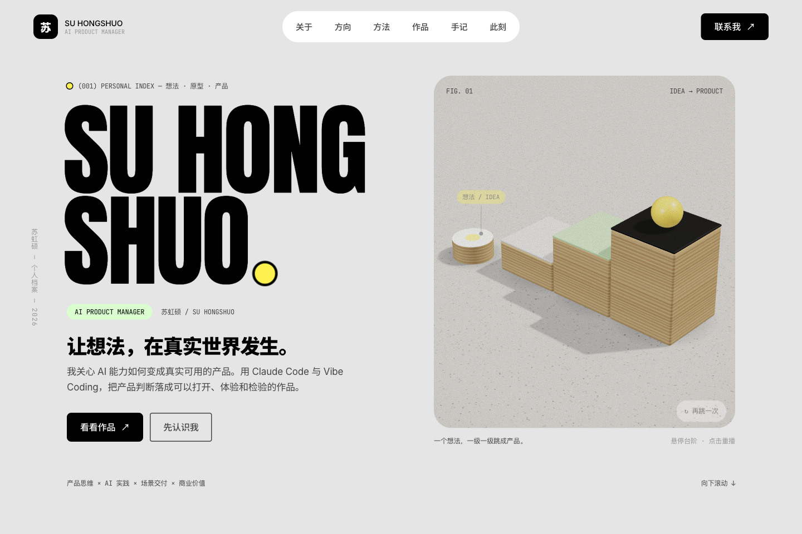

  

<h1 align="center">苏虹硕 · AI 产品经理</h1>

<b>让想法，在真实世界发生。</b>

  
  
  
  
  
  

  <a href="https://suhongshuo6-cell.github.io/"><b>个人网站 ↗</b></a> &nbsp;·&nbsp;
  <a href="#user-content--作品"><b>作品</b></a> &nbsp;·&nbsp;
  <a href="#user-content--工作方式"><b>工作方式</b></a> &nbsp;·&nbsp;
  <a href="https://suhongshuo6-cell.github.io/#contact"><b>联系我 ↗</b></a>

 

> 比起“这个能不能用 AI 做”，我更在意 **“这件事值不值得做”**。
> 我用 Claude / Claude Code 与 Vibe Coding，把产品判断落成可以打开、体验和检验的作品，关注 FDE 场景交付与商业化。

 

## 🚀 作品

<table>
  <tr>
    <td width="50%" valign="top">
      <h3>🎮 Open game.ai</h3>
      
<b>一句话想法，变成经过审查、可以直接玩的游戏。</b>

      
本地优先的 AI 游戏制作 Agent：Planner → Implementer → Reviewer → 构建 → 自动试玩，不过关就有限轮次返工，产出独立的 Web 或 Godot 4 项目。

      
<code>TypeScript</code> <code>Agent</code> <code>Godot 4</code> <code>MIT</code>

      
<a href="https://github.com/suhongshuo6-cell/Open-game.ai"><b>源码 ↗</b></a> &nbsp;·&nbsp; <a href="https://suhongshuo6-cell.github.io/Open-game.ai/"><b>项目主页 ↗</b></a>

    </td>
    <td width="50%" valign="top">
      <h3>📖 艾迷森 Immersion</h3>
      
<b>作者写骨架，AI 补血肉的互动小说。</b>

      
基于开源 AINT 运行时二次开发，新增叙事规则层、galgame 系统与 AI 模拟玩家评测；附完整 PRD、开源选型与多 Agent 分工文档。

      
<code>Go</code> <code>React</code> <code>互动叙事</code> <code>AI 评测</code>

      
<a href="https://github.com/suhongshuo6-cell/aimisen-code"><b>源码 ↗</b></a>

    </td>
  </tr>
  <tr>
    <td width="50%" valign="top">
      <h3>🛡️ Claude Shield</h3>
      
<b>给 Claude 的本机连接，增加可观察的守护。</b>

      
面向 macOS 上的 Claude Desktop 与 Claude Code，检查出口 IP、地区与配置基线，异常时阻断已接入守护的流量，并在本地展示状态与日志。

      
<code>Swift</code> <code>macOS</code> <code>连接监测</code>

      
<a href="https://github.com/suhongshuo6-cell/claude-shield"><b>源码 ↗</b></a> &nbsp;·&nbsp; <a href="https://suhongshuo6-cell.github.io/claude-shield/"><b>项目介绍 ↗</b></a>

      开源实验，非通用安装包；“防封”为项目名，不代表账号安全保证。
    </td>
    <td width="50%" valign="top">
      <h3>🌐 个人网站 v2</h3>
      
<b>把“我是谁、怎么做、做过什么”当成一个产品来设计。</b>

      
黑白灰与薄荷绿、Three.js 互动首屏，让想法沿着“问题 → 原型 → 产品”逐级落地；含关于、方法、作品、手记、此刻等七个区块。

      
<code>Three.js</code> <code>HTML/CSS/JS</code> <code>GitHub Pages</code>

      
<a href="https://suhongshuo6-cell.github.io/"><b>访问 ↗</b></a> &nbsp;·&nbsp; <a href="https://github.com/suhongshuo6-cell/suhongshuo6-cell.github.io"><b>源码 ↗</b></a>

    </td>
  </tr>
</table>

## 🧭 工作方式

<table>
  <tr>
    <td width="33%" valign="top">
      <b>01 · 从问题开始</b>  
      先理解用户与场景，再判断要不要 AI。 
      拿掉 AI 这个标签，用户还需要它吗？
    </td>
    <td width="33%" valign="top">
      <b>02 · 用作品验证</b>  
      把想法做成能打开的原型，让判断接受体验检验。 
      讨论十遍方案，不如做一个能打开的版本。
    </td>
    <td width="33%" valign="top">
      <b>03 · 连起交付与价值</b>  
      同时看使用体验、落地条件和商业化路径。 
      用户是否更稳定、更轻松地完成了任务？
    </td>
  </tr>
</table>

| 方向 | 我关注的问题 |
| :--- | :--- |
| **产品思维** | 用户真正要解决什么？优先级是什么？怎样用原型验证判断？ |
| **Claude · Claude Code** | 如何把 AI 放进设计、编码、验证与迭代的工作流？ |
| **Vibe Coding** | 如何缩短从想法到可交互作品的距离？ |
| **FDE · 场景交付** | 如何贴近真实场景，让方案可运行、可观察？ |
| **商业化** | 产品为谁创造价值？价值如何衡量并持续？ |

## ✍️ 手记 &nbsp;·&nbsp; 🟢 此刻

<table>
  <tr>
    <td width="50%" valign="top">
      <b>产品手记</b>  
      · 先找到值得解决的问题，再谈 AI 的可能 
      · 好的 AI 体验，也包括知道何时交还控制权 
      · 从一个惊艳的 Demo，到一个可靠的产品  
      <a href="https://suhongshuo6-cell.github.io/#notes">阅读手记 ↗</a>
    </td>
    <td width="50%" valign="top">
      <b>2026.11</b>  
      · <b>Open game.ai</b>：开发者预览，打磨审查与自动试玩闭环 
      · <b>Claude Shield</b>：源码与隔离测试阶段 
      · <b>正在思考</b>：人如何与智能协作完成真实任务  
      <a href="https://suhongshuo6-cell.github.io/#now">查看此刻 ↗</a>
    </td>
  </tr>
</table>

 

  产品思维 × AI 实践 × 场景交付 × 商业价值 
  <a href="https://suhongshuo6-cell.github.io/"><b>进入我的个人网站 ↗</b></a> &nbsp;·&nbsp;
  <a href="https://github.com/suhongshuo6-cell?tab=repositories">全部仓库 ↗</a>

