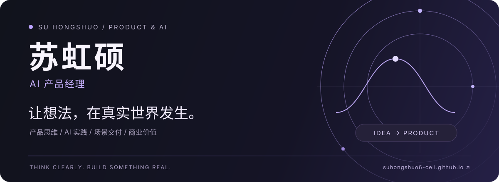

  

  <a href="https://suhongshuo6-cell.github.io/"><strong>个人网站 ↗</strong></a> &nbsp; · &nbsp;
  <a href="#-全部公开项目"><strong>查看项目</strong></a> &nbsp; · &nbsp;
  <a href="#-技能与关注方向"><strong>技能与标签</strong></a> &nbsp; · &nbsp;
  <a href="https://github.com/suhongshuo6-cell?tab=repositories"><strong>仓库列表 ↗</strong></a>

## 你好，我是苏虹硕

**AI 产品经理，关注 AI 能力如何变成真实可用的产品。**

我关心需求背后的问题，也关心产品最终如何被使用、如何交付、如何创造商业价值。用 Claude / Claude Code 与 Vibe Coding 探索想法，把产品思考落到可以打开、体验和检验的作品上。

> 让想法，在真实世界发生。

## 🧩 技能与关注方向

  
  
  
  
  
  

| 方向 | 我关注的问题 |
| :--- | :--- |
| **产品经理 · 产品思维** | 用户真正要解决什么？需求的优先级是什么？怎样用原型验证判断？ |
| **Claude · Claude Code** | 如何把 AI 放进产品设计、编码、验证与迭代的工作流程？ |
| **Vibe Coding** | 如何缩短从想法到可交互作品的距离，并检查实际体验？ |
| **FDE · 场景交付** | 如何贴近真实使用场景，让方案成为可运行、可观察的交付？ |
| **商业化** | 产品为谁创造价值？价值如何被衡量，如何形成可持续的业务？ |

## 🚀 全部公开项目

### 01 · Claude Shield / Claude 防封守护盾

**给 Claude 的本机连接，增加可观察的守护。**

面向 macOS 上的 Claude Desktop 与 Claude Code，检查出口 IP、地区、配置基线和验证状态；在连接异常时阻断已经接入守护的流量，并通过本地界面展示状态与日志。

`Swift` `macOS` `Claude Desktop` `Claude Code` `连接状态监测`

**[查看源码 ↗](https://github.com/suhongshuo6-cell/claude-shield)** &nbsp; · &nbsp; **[项目介绍 ↗](https://suhongshuo6-cell.github.io/claude-shield/)**

开源实验，已公开源码与隔离测试；当前不是通用安装包。“防封”为项目名称，不代表账号安全保证。

---

### 02 · 苏虹硕的个人网站

**一个展示我是谁、在做什么、如何思考的个人空间。**

以个人介绍、项目展示和产品思考为核心，采用深色视觉与中英文字体排版，并通过 GitHub Pages 公开访问。

`HTML` `CSS` `JavaScript` `GitHub Pages` `个人品牌`

**[访问网站 ↗](https://suhongshuo6-cell.github.io/)** &nbsp; · &nbsp; **[查看源码 ↗](https://github.com/suhongshuo6-cell/suhongshuo6-cell.github.io)**

---

主页本身也开源在 <a href="https://github.com/suhongshuo6-cell/suhongshuo6-cell">suhongshuo6-cell</a>。更多更新可查看 <a href="https://github.com/suhongshuo6-cell?tab=repositories">全部公开仓库</a>。

## 🧭 我的产品视角

- **从问题开始**：先理解用户与场景，再判断是否需要 AI、需要怎样的产品。
- **用作品验证**：把抽象的想法变成原型与实际交互，让判断接受体验的检验。
- **把交付与价值连起来**：同时关注使用体验、落地条件和商业化路径。

 

  <strong>苏虹硕 · AI 产品经理</strong> 
  产品思维 × AI 实践 × 场景交付 × 商业价值  
  <a href="https://suhongshuo6-cell.github.io/">进入我的个人网站 ↗</a>

